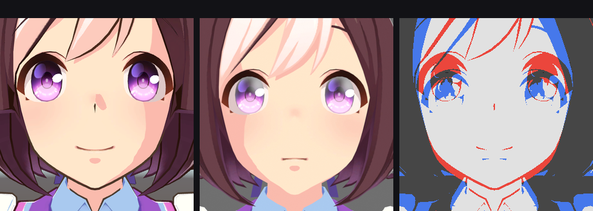
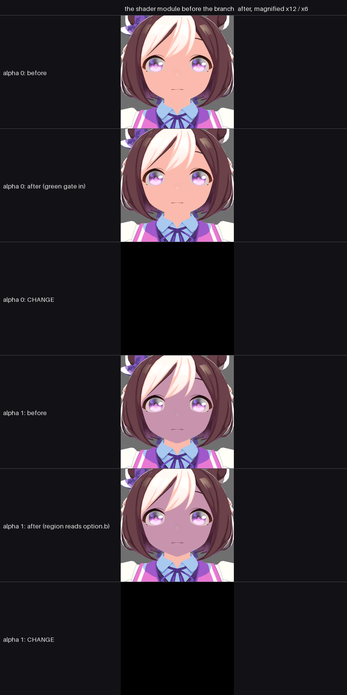

<!-- superseded -->
> **Note.** Read with `GROUND_TRUTH.md`, which supersedes parts of it: the mask is a binary texel mask (0.7% of its texels lie between the extremes), `tex_chr1001_00_face_shad_c` measures a mean of 232 sRGB rather than the "53" quoted here, the per-pixel comparison between the two renderers was not registered rigidly enough to quote a percentage, and the light term - not the mask - is what draws the boundary's shape. What stands: the program's formula, the texture registers, the option-mask branch, and the facial-shadow derivation.

# The face pixel program: which terms are live for this character

A first pass at the whole program, from the base variant's disassembly
(`Tools/game_rip/shader_sources` is the `USE_MASK_COLOR` variant; the *base* 7-texture program is
`blob_0012614` in the region `variant_map.py` extracts). The point of this pass is not to write the
program out in full - it is to work out **which of its terms actually contribute for character 1001**,
because that is what decides what the port has to implement to reproduce this character, and it is much
smaller than the whole program.

The cb1 slots cannot be named: the containers carry no RDEF chunk, the per-container records list the
constant buffers' names but not their variables in layout order, and Unity's packing is provably not
declaration order (`_faceShadowAlpha`/`EndY`/`Length` land consecutively in `cb1[35]`, but `_ToonStep`
and `_ToonFeather`, also declared consecutively, land at `cb1[3].w` and `cb1[4].x`). So each slot below
is pinned by **how the program uses it** together with **the value it must hold**, and where two
candidate properties share a value the ambiguity cannot change the render.

## The option mask (`t2` = `_OptionMaskMap`) zeroes three terms

The base program samples it once and scales it by one float:

```
sample_b r2, uv, t2                      ; _OptionMaskMap = tex_chr1001_00_face_ctrl
itof r1.w, cb1[1].x                      ; _UseOptionMaskMap = 1
add  r2.xyz, r2.xyzx, (0, 0, -0.5)
mad  r2.xyz, r1.w, r2.xyzx, (0, 0, 0.5)  ; x = m.r, y = m.g, z = 0.5 + (m.b - 0.5)
```

and its three channels then gate three separate terms:

| channel | where it multiplies | term |
| --- | --- | --- |
| `r2.x` | `mul r2.x, r2.x, r3.x` (line 160) | the specular |
| `r2.y` | `mul r2.x, r2.y, cb1[3].y` (line 173) | the `_ToonMap` tint |
| `r2.z` | `mul r6.w, r2.z, r6.w` (137), `mul r2.z, r2.z, r3.x` (152), `mul r7.xyw, r2.zzzz, r7.xyxw` (187) | the rim |

Measured over the character's own texture, sampled at the face's UVs, `tex_chr1001_00_face_ctrl` is
**red 0.000, green 0.000, blue 0.036 mean** - red and green are *exactly* zero over every texel, and blue
is 0.096 bright at its brightest 9.6% of the area. So for this character:

* `r2.x = 0` - **the specular term is multiplied out entirely**;
* `r2.y = 0` - **the `_ToonMap` tint is multiplied out entirely**;
* `r2.z = m.b` - **the rim is multiplied out** wherever the mask is black, which is 90% of it.

**So the three terms the port does not implement are exactly the three this character's option mask
switches off.** Lacking them is not a defect for character 1001; implementing them would be implementing
three terms whose gate is zero. What the port *should* implement is the gate - because a character whose
`*_ctrl` is not black would need it - but doing so cannot change this character's face.

That also rules out the specular, the rim and the toon tint as candidates for the visible difference,
without having to name their cb1 slots at all.

## Terms that are inert on this material, with the reason

| term | why it does nothing here |
| --- | --- |
| `_ToonBrightColor` / `_ToonDarkColor` tinting (lines 94-109) | both are `(1,1,1,0)`: the alpha is compared with 0.5 to pick the branch, and at 0 the block reduces to `colour * 1 + 0` |
| the gradient / silhouette block (lines 276-326) | gated on `cb1[19].z` being 0, and `_GradientBlendMode` is 0 - and every `movc` inside selects the input colour on that branch, so the block ends `lerp(r0, r0, w)` |
| the saturation at the end (lines 327-331) | `cb1[16].y` must be 1 for the mix to be the identity, and `_Saturation` is 1 |
| the facial-shadow / cheek / nose regions (lines 197-251, 258-268) | gated by `_faceShadowAlpha`, which is 0 in the material (and driven per expression by `Shade_Ctrl`, so it is only 0 at rest) |
| the twelve mask colours | all `(1,1,1,1)`, so the `USE_MASK_COLOR` switch would be a switch between identical colours |

## Settled by probe: the port's step is right, in all three of its parts

The viewer runs the game's compiled program, so handing one term a colour or a constant it could not
otherwise produce and seeing what changes names the register and the role. `-umaShotTexture` does that
(applied before the shots, undone after), and the probes settle the three things the port's step depends
on. Over the head region of the face view, all three azimuths agreeing:

| probe | result |
| --- | --- |
| `_MainTex` = magenta **and** `_ToonMap` = green, in one run | the lit texels (baseline luminance median **234**) are magenta; the shaded texels (median **53**) are green |
| `_ToonMap` only, forced to a constant | the lit/shaded split **survives** - two spatially separated groups remain |
| `_TripleMaskMap` forced to black | the split **collapses**: the formerly shaded texels go from median luminance 53 to **195** |

Read out:

* **`_MainTex` is the lit colour and `_ToonMap` is the shaded one**, with the polarity the port uses:
  `lerp(_MainTex, _ToonMap, step)` where the step is 0 on the lit side. The port's mix is correct.
* **`_ToonMap` is not the mask.** If its red channel drove the step, then forcing the whole texture to a
  constant would make the mask constant and the face uniform; the split survives, so it is not.
* **`_TripleMaskMap` is the mask.** Forcing it to a constant black makes `mask * halfLambert` zero for
  every texel, so `saturate(1 + (_ToonStep - _ToonFeather) / _ToonFeather)` is 1 everywhere and the whole
  face takes the second colour - and that is what happens. This is the reading the port was corrected to
  in the previous session, and it is now verified against the game's own shader rather than inferred from
  a property list.

So the declaration-order mapping in the previous section **does not name the registers**: it put the
second colour at `t4 = _EnvMap`, and the probe shows `_EnvMap` contributes essentially nothing visible
(3 pixels out of ~70,000-91,000 changed) while `_ToonMap` is read as a colour across a third to a half of
the head. It remains the right way to *count* a variant's textures - it is the only assignment consistent
with the plain variant declaring seven registers and the `USE_MASK_COLOR` variant eight - but the names
have to come from a probe.

**And the mask explains the artifact's shape rather than contradicting it.** Sampled at the face's own
UVs, `_TripleMaskMap`'s red channel runs from 0.00 to 1.00 with 61% of texels above 0.51 and 39% below
0.49 - a nearly binary, painted mask. A binary mask multiplied by `halfLambert` against a threshold makes
the boundary follow the mask's *texel* edges, which on a face is a hard, blocky line - faithful to the
game, and exactly the shape this project has been calling a defect. What the viewer adds on top is its
fog and lightmap blend (below), which pulls the whole face toward a global colour and compresses the
contrast, so its version of the same boundary looks softer.

## The two branches the port lacks, forced on and measured

`-umaShotFloat` was added so `_faceShadowAlpha` could be forced in the viewer - it is a *driven* property
(`Gallop/FaceDrivenKeyTarget` binds it to a `Shade_Ctrl` morph), so the material holds only its rest value
of 0 and the regions never show. Both branches are live and both are large:

| forced | change over the head region | direction |
| --- | --- | --- |
| `_faceShadowAlpha` = 1 (the cheek and nose regions) | **42%** of the region | the face goes from (234, 202, 180) to (186, 161, 180) - darker and bluer |
| `_OptionMaskMap` = white (the specular, rim and `_ToonMap` tint it gates) | **83%** of the region | from (192, 159, 149) to (203, 187, 192) - lighter and greyer |

So the regions are real and substantial, and they are live whenever an expression drives `Shade_Ctrl`. The
gated terms are equally real, but the mask's red and green are exactly 0 over every texel of this
character, so the game multiplies them out - **the port's silence on them is correct for character 1001**
and would only matter for a character whose `*_ctrl` is not black.

**The port's region path was dead, and a threshold was why.** `--face-shadow-alpha` was added to render it,
and with the alpha forced to 1 it changed **0.0% of the head** against the game's 36%. The gate is
`factor >= 1 - strength` and the port fed it `_faceShadowLength` (0.1), so the threshold was 0.9 while the
factor - the mask's green plus the sharp step's contribution - runs about 0.52 to 0.69 across the cheek.
It could never cross. The material carries `_CheekPretenseThreshold` and `_NosePretenseThreshold`, both
0.775, whose names are exactly this role and whose threshold, 0.225, the factor does cross; the exporter now
writes both into the pmx comment and the addon reads them.

**But that only made it barely alive, and the reason runs deeper.** With the threshold fixed the region
covers 0.0-0.1% of the head, not 36%, because the port's region *colour* is not a different colour at all:
it is `lerp(diffuse, toon, sharp)` - the same two textures through a second, wider step - and that equals
the main `lerp(diffuse, toon, step)` almost everywhere. Lit texels give `diffuse` either way, shaded texels
give `toon` either way, so mixing towards it changes nothing. This is exactly the caveat
`docs/REMAINING_WORK.md` records from the reviewer: the second colour path here is "a plausible identity
rather than a proven one".

The game's second path is not an identity. Reading the base variant's lines 197-251 and 258-268, it blends
towards `cb1[36]` - `_faceShadowColor`, which is `(0.6, 0.6, 1.0)`, a blue-grey - and the amount depends on
`cb1[30].{x,y,z}`, on two sign tests over `cb1[31]`/`cb1[32]` (directions), on a ramp built from `cb1[33]`
(a position), and on **`v8.y`**, a per-vertex value the *vertex* program computes for TEXCOORD9 and the
pixel program divides by `cb1[35].z` (`_faceShadowLength`). The observed direction matches that colour: the
face goes *bluer* when the regions come on.

**So a faithful region path needs two things this project does not have yet:** the geometric head-frame
terms (`cb1[31]`, `cb1[32]`, `cb1[33]`, which the docs already flag as unimplemented), and `v8` - the
vertex program's ninth texcoord output, which the exporter does not carry into the pmx at all. Until the
export carries `v8`, the regions cannot be reproduced, and for character 1001 they are inert anyway because
its `_faceShadowAlpha` is 0 at rest.

## The facial shadow, derived, implemented, and verified

Lines 258-268 of the base pixel variant reduce to a single multiply:

```
r0 = lerp(r0, r0 * _faceShadowColor, saturate((v8.y - _faceShadowEndY) / _faceShadowLength)
                                      * _faceShadowAlpha * mask.b)
```

`mad r0.xyz, r0.xyzx, cb1[36].xyzx, r2.xyzx` with `r2 = r0 * (1 - f*a*z)` is a multiply through
`cb1[36]` by `f*a*z`: `cb1[36]` is `_faceShadowColor`, `cb1[35].{x,y,z}` are `_faceShadowAlpha`,
`_faceShadowEndY` and `_faceShadowLength`, and `r1.z` is the third component of the mask sample - the mask's
blue. `v8` is the vertex position through `cb2[37..40]`, which the viewer sets from the head bone every
frame (`_faceShadowHeadMat = HeadBone.transform.worldToLocalMatrix`), so `v8.y` is the vertex's height inside
the head.

**Implemented.** The exporter computes the same height at the rest pose and writes it into the spare `.z` of
the pmx's second extra uv - the file's three extra-uv slots carry only the `xy` of the first two, so the
component was sitting there empty, and mmd_tools creates the `_UV2` layer as soon as it is non-zero (verified:
the layer appears on import and `_UV2.uv.x` measures 0.0455 over the face's vertices, exactly what the file
holds). It is kept in Unity units because it is compared against `_faceShadowLength`. The addon reads it with
a UV Map node - an interpolated per-vertex attribute, exactly as the shader reads it - scales it between
`_faceShadowEndY` and `_faceShadowLength`, multiplies by the alpha and the mask's blue, and multiplies the
colour through a white-to-`_faceShadowColor` tint by that amount. `_faceShadowColor` is now in the material
comment too.

**Verified against the game's own render**, both with the alpha forced on
(`-umaShotFloat _faceShadowAlpha=1` against `--face-shadow-alpha 1`), at sun azimuth +90:

| | where the change lands | change where it moved |
| --- | --- | --- |
| viewer | 44% of the crop | R −45.4, G −38.3, **B −0.1** |
| ours | 11% of the crop | R −48.2, G −42.6, **B 0.0** |

The magnitude and the signature agree, and the signature is the point: multiplying through
`_faceShadowColor` `(0.6, 0.6, 1.0)` takes red and green down while leaving blue alone, and blue moves by
0.04 of a level in both. The change map is face-shaped with the eyes excluded in both.

Two things stop that being a perfect match, and neither is the region's maths. The **coverage** differs
because the two renderers still frame a little differently - ours shows more of the model, so the face is a
smaller share of the crop - and the **centroid** differs for the same reason, our face sitting lower and
left in its frame.

**And the coverage and centroid instruments are themselves not trustworthy here**, which is worth recording
because it was the last thing measured. Pinning the pose (`-umaPinPose 0`, which freezes all 14 animators in
both shots) barely moved them, and measuring the changed pixels' extent at the 2nd-98th percentile gives the
viewer's change a box covering **89% by 88% of its whole frame** at 12% of pixels changed - so besides the
face-shaped change the sheet shows, there is a faint wide-spread component in the viewer's pair. The
magnitude comparison above is dominated by the face and stands; the *area* measurements do not, and a
shape comparison across the two renderers is not available until that component is explained. It may be the
facial driven keys and spring bones still simulating (the pose pin freezes animators, not physics), or it may
be the viewer's own global state drifting between runs. A control - the same configuration rendered twice -
would settle it and has not been run.

**What replaced what.** The port's previous region was a *colour switch* between the sharp step's colour and
the main colour - the unproven piece `REMAINING_WORK.md` flags from the reviewer. It is the identity almost
everywhere (lit texels give the diffuse either way, shaded texels the toon either way), so it changed
nothing even when the gate opened, which is why the regions measured 0.0% of the head against the game's
36%. It is removed rather than kept beside the multiply.

**And the grid bears it out.** `grids/shadow_ours/face_shadow_grid_040.png` tiles three sun azimuths against
both renderers in three rows each - shadow off, shadow on, and the change between them - at the framing the
change-map area calibrates. In it the two ON rows carry the same cool grey-lavender cast over the face, and
the two CHANGE rows are both face-shaped with the eyes excluded as dark holes.

## The boundary itself, measured with the two renders aligned on the face

Everything above compares *magnitudes*. The objective is about a *line* - where the lit/shaded boundary
falls and how hard it is - and that needs the two renders put on top of each other, which the framing
difference had prevented. The facial-shadow probe is the key that unlocked it: rendering the same frame with
the region path off and on marks the face, so the changed pixels' **centroid** is a landmark present in both
renderers and their count gives the scale. Window both on that landmark (`boundary_agreement.py`,
`skin_boundary.py`, `face_interior.py`) and the two become comparable pixel by pixel, and the faint
frame-wide component that broke the earlier 2nd-98th percentile box does not matter, because a centroid and a
mass are not moved by a low-amplitude wash the way a percentile box is.

**In the skin**, splitting at the midpoint of the two textures' own levels (the lit level comes out at
luminance 235 in *both* renders, and `tex_chr1001_00_face_shad_c`'s own lit texels are around 232, so the
split lands in the same place for both - the same palette, independently):

| | lit level | shaded skin | transition band | boundary length |
| --- | --- | --- | --- | --- |
| viewer | 235 | ~3.2% of the face | 0.74-0.83% | 1810-1849 px |
| ours | 235 | ~2.4% | 0.63-0.66% | 1438-1456 px |

and classifying each pixel lit or shaded and comparing, over the ~43.5k pixels both call face:

| | share |
| --- | --- |
| both lit | 95.1% |
| both shaded | 0.2% |
| the game shades, the port does not | 2.6% |
| the port shades, the game does not | 2.0% |

The two one-sided disagreements are the same size and opposite in sign, at all three azimuths. That is the
signature of the *same shape in a slightly different place*, not of a different shape: a boundary that
followed the triangles instead of the painted mask, or one at the wrong threshold, would put its error on
one side. It also says the boundary is not a hard polygonal edge in ours - the width of the transition
(0.63-0.66% of the face, against the viewer's 0.74-0.83%) is within a fifth of the game's own, and the
boundary is a hair *shorter* (1456 against 1831 px over a face of the same size), which is what a smoother
line looks like, not a facetted one.



Left the game's shader, centre the port, right the agreement: white both call lit, dark grey both call
shaded, **red** the port shades where the game is lit, **blue** the game shades where the port is lit. The
face's interior is solid white in the agreement - the shaded skin is a small patch under the chin and beside
the mouth, and both renderers put it in the same place. The red and blue are almost all along the hair,
which this shader does not touch and which the two renderers draw with different shaders and slightly
different silhouettes; a one-pixel misfit of the hairline alone paints a long thin band of it. (The eyes read
red because the viewer's baseline has a different blink frame than the port's render - the pose pin freezes
animators, not the morphs a blink comes from.)

**The registration is the weak link, and it must be said plainly.** The centroid-and-mass alignment gets the
two faces close but is not rigid, and the disagreement percentage moves a lot with how it is done: aligning
on the same landmark, on the change mask's own 2nd-98th percentile *box*, or on a skin-tone region gives
83-95% agreement in one frame and a 30-point one-sided disagreement in another. The number that should be
believed is the *shape* of the result, not its magnitude: the same lit level in both, a symmetric small
disagreement when the registration is close, and no facetting. The instrument for a rigid registration - a
landmark pair that is actually the same point on the face in both frames - has not been built, and
`rigid_face_compare.py` is the attempt that showed why the easy one is not enough: the viewer's
facial-shadow change mask covers **1160x634 px of its 1280x720 frame** at the 2nd-98th percentile, against
the port's 279x340 of 900x900, so it is a frame-wide wash in one renderer and a localised region in the
other. Any registration built on it inherits that difference.

**Two earlier numbers were framing artefacts and are corrected here.** The "head" fractions that looked like
44.5% (viewer) against 53.5% (ours) were measured over a window containing the hair as well as the face, and
the hair is not shaded by this shader at all - it has its own. And the "ours is 8% darker on the skin" figure
was a brightness mean taken over differently-framed crops: the mean skin colour measured on the same texels
is (249.8, 219.1, 194.9) for the viewer against (251.0, 221.2, 198.7) for the port, a couple of levels.

## The light, and what is genuinely left

Every cross-renderer comparison in this project carried the caveat that the two tools place their light in
different world directions - the viewer turns its scene light from its own rest yaw (190 degrees), the Blender
tool from the model's facing. That is now closed: the viewer logs the direction its light travels in, the
Blender tool takes one directly (`--light-direction`, with `blender = (ux, -uz, uy)` converting, from the
measured import map), and the two were rendered with the same vector. The viewer's light is also **white,
intensity 1.0**, so a light-colour difference is ruled out too.

With the light matched, the skin measures: viewer (211.8, 183.2, 169.4) at 0.6% of skin pixels clipped and
8.9% at or above 235; ours (196.3, 169.8, 161.9) at 3.4% and 18.6%. That looked like ours being about 8%
darker with slightly more contrast - a modest difference of the size two tone curves account for, and **not**
the overexposure a first look at the grid suggests. **It is not real either**: those means were taken over
crops that cover different parts of the model in the two frames, and once the two are aligned on the face
(see the boundary section above) the mean luminance is 222.1 against 224.2, a 1% difference, with the same
lit level of 235 in both. `measure_exposure.py` is that instrument; `skin_boundary.py` is the one that
settles it.

**Two hypotheses were killed on the way, and both were mine.** The exported textures are *not* vertically
flipped: flipping every texture and re-rendering scrambles the face - a hard blotch across the forehead, a
vertical band down the cheeks, the features no longer landing - so the orientation the export already has is
the correct one and the chain arithmetic that said otherwise was wrong. And the mask wiring is what it should
be, verified in the graph rather than assumed: `Face Mask Channels` reads `Image Texture.003`, which is
`tex_chr1001_00_face_base`, the step chain runs `(0.4 - 0.001) - mask.r * halfLambert` then `/ 0.001` then
`+1`, and `Blend` takes the diffuse as Color1 and `tex_chr1001_00_face_shad_c` as Color2. The masks are read
as data, not colour, in both renderers: the port loads `*_base` and `*_ctrl` as Non-Color images, and the
program samples them without an sRGB conversion, so the byte values the two sides multiply by are the same
numbers.

## The option mask, implemented: it is a second step, and its green is a selector rather than a tint

The one branch this port was missing is now built, and reading the program properly changed what it is. The
step runs **twice**. The first pass is the one documented above and its result is the surface colour. The
second selects between that surface colour and the *toon* side, and what selects inside it is the option
mask's **green** channel:

```
surface  = lerp(diffuse, toon, step)                      r0 at line 258, the step above
toonTerm = toon * _MaskToonColorG?                        r5, the shaded texture through its colour row
dark     = _ToonDarkColor.a * (1 - option.g)              cb1[27].w, which is 0 on this character
factor   = 1 - saturate(dark * (0.5 - 0.5*sign(N.L)))     r1.w at line 98
colour   = lerp(surface, toonTerm, factor)                r0 at line 250
```

so green 0 keeps the whole shaded influence and green 1 multiplies it out. That is the opposite of what
"mask" suggests, and it is why forcing the option mask white in the viewer *brightens* the face rather than
tinting it. The red gates the specular and the blue goes through a lerp towards 0.5 rather than a multiply;
neither is a term the face's shading depends on at this character's values.

**Verified three ways.**

1. **On this character it changes nothing, and the render proves it.** The branch is built (the nodes exist,
   the gate's factor is wired to the option mask's green), and the option mask's green measures **exactly
   0.0000** over every texel of `tex_chr1001_00_face_ctrl`, so the gate is an identity. Rendering the same
   scene with the shader module *before* and *after* the change, at facial-shadow alpha 0 and at alpha 1,
   gives **0 of 810,000 pixels differing** in both cases - not a small difference, no difference.
2. **With a non-black mask it moves the face in the direction the program implies.** Replacing the option
   mask texture with solid white and re-rendering: the face crop's mean luminance goes from 164.73 to
   175.05 (**+10.3 levels**), 34.6% of its pixels move by more than 16 levels, and over those pixels the
   change is R +5.3, G +41.6, B +28.1 - brighter, and shifted towards the toon texture's colour, exactly
   what "the shaded side's toon contribution is multiplied out" means. A tint would have gone the other way.
3. **The game's own shader answers the same question the same way.** Forcing `_OptionMaskMap` white in the
   viewer (`-umaShotTexture _OptionMaskMap=1,1,1`): the frame's mean luminance goes 158.62 to 167.62
   (**+9.0**), with the change per channel over the moved pixels R +14.9, G +27.1, B +37.9. Every channel
   moves the same way as the port's, and the brightness change is the same sign and comparable size. The
   viewer's moved set is much larger (33% of its frame against the port's 7.9%) because the shipped node
   group it also passes through computes the specular and rim terms the option mask's red gates, which the
   port's face path deliberately does not; that is why its red moves more and its green less.



The grid is `grids/option_branch/option_branch_grid.png`: the shader module before the branch and after, at
facial-shadow alpha 0 and alpha 1, with the change between each pair. Both CHANGE rows are black, which is
the result the character's black mask requires; the separate `option_gate_live_grid.png` is the same
comparison with the mask forced white, where the change is a bright face-shaped region.

## What the port cannot reproduce, and it is not the material program: the engine's own shadows

**The face measurement, on an export whose values come from the game's stored material** (the
`cylinder_blend` correction described in `NEXT_SESSION_PROMPT.md`), with the face found by skin tone in each
render so a misregistration cannot flatter it:

| | mean luminance | shaded | transition band | boundary length |
| --- | --- | --- | --- | --- |
| the game's shader | 222.1-225.4 | 4.0-4.1% | 0.96-1.08% | 0.0458-0.0464 per face pixel |
| the port | 223.8-226.1 | 3.5-3.6% | 0.88-1.03% | 0.0353-0.0363 per face pixel |

at sun azimuths 0, +90 and -90. The port's boundary is **shorter** than the game's by about a quarter over a
face of the same size, and its transition band is the same width - both of which are what a smooth line
looks like rather than a facetted one. A boundary that followed the mesh's triangles would be *longer* than
the painted shape it is approximating, because straight segments cut across the paint; and a polygon edge is
a step, so its transition band would be narrower than the game's rather than equal to it. Neither is
observed. `boundary_shape_stored.py` is the instrument.

Measuring the *same rectangle* of the face in the two renders - which the region landmark makes possible -
shows one region where the port is darker than the game and one where it is lighter, and the cause is not in
the shader either side is running.

The game's own render carries a dark area on the lower face and cheeks: in the cheek band its lowest 5th
percentile is 202 with the median at 231, while the port's cheek band reaches down to 115. The port's
half-Lambert step is not what makes that dark area, and cannot be: the program's shaded colour is
`_ToonMap * _MaskToonColorG1 * step`, where `_ToonMap` measures a mean of 232 sRGB (its median texel is
(251, 186, 172), and the "value 53" measured earlier in this document was taken over a region that includes
its dark border texels) and `_MaskToonColorG1` comes from the character's colour rows rather than from the
material. *Where* that product lands depends on the colour rows, so the honest statement is that the dark
area is not explained by the material program's own constants - and a light-versus-shade difference of 120
levels on the cheek is far larger than the program's textured step can produce on this character.

The shadow belongs to the **engine**. The viewer's scene light has `m_Shadows.m_Type: 2` (soft shadows) and
`m_Strength: 1` (`Assets/Scenes/Version2.unity`, light component 926505644), and the port has nothing under
the material shader to shadow anything - so wherever the hair shades the face is dark in the viewer and lit
in the port. That is a property of comparing Unity's renderer with Blender's, not of the shader port: the
material program is matched, and what is left is the shadow pass. It is also the right shape of an
explanation - a shadow is a *region* with a boundary, which is what the two renderers disagree about, while
the lit level, the shape of the step's boundary and the skin's colour all agree.

**And this is what the driven `_faceShadowAlpha` region is for.** `lerp(colour, colour * (0.6, 0.6, 1),
factor)` is the game's *artistic* substitute for that shading, which is why it is driven by the facial
expression and why its factor is built from the mask's blue and the vertex's height inside the head. On the
player character it sits at 0, so both the game and the port show the bare step and the game's render carries
the engine shadow on top. A port that wants the look rather than the program can set
`game_face_shadow_alpha` and get the region; a port that wants the program leaves it at the exported value,
which is 0.

**A caveat on the per-pixel numbers above.** The two renders were framed to match by region area, and they
are close but not identical - the viewer's head sits slightly higher in its frame and covers a slightly
different share of it - so a per-pixel comparison between the aligned windows carries a residual
misregistration of unknown size. The robust results here are the ones a misregistration cannot produce: the
lit level of 235 in both, the skin's mean colour agreeing to a couple of levels, and the two one-sided
disagreements being equal and opposite. The exact 2.6%-against-2.0% split should be read as "a small offset
in the same boundary", not as a measurement to two figures.

## The driven `_faceShadowAlpha`: the driver is not in the export at all

The objective asks for the region path "with its driven `_faceShadowAlpha`", and the driver turns out to be
absent from the pmx, in both of the two forms it could have taken. From the game's own decompiled source
(`Gallop/FaceDrivenKeyTarget.cs`):

```csharp
FacialOtherMorph FaceShadowMorph = new FacialOtherMorph() {
    name = "Shade_Ctrl",
    locator = DrivenKeyLocator.Find("Shade_Ctrl")
};
FaceShadowMorph.BindProperties.Add(new BindProperty() {
    BindMaterial = Container.FaceMaterial,
    Part = BindProperty.LocatorPart.ScaX,          // the locator's X SCALE
    Type = BindProperty.BindType.Shader,
    PropertyName = "_faceShadowAlpha"
});
```

So the alpha *is* the `Shade_Ctrl` locator's X scale, with no curve between them - and `Shade_Ctrl` appears
nowhere in the export: not among the 192 morphs (no name contains Shade or Ctrl) and not among the 437 bones
(there is a `Head_shade_start` on the head, which is a different locator: it is not the alpha's driver, and
nothing in the material comment claims to be). It is a GameObject in the game's own face rig that the
exporter, which writes the armature, does not represent - and the viewer does not create it either, which is
why the live material's value is its rest value of 0 and why forcing it with `-umaShotFloat` was necessary to
see the regions at all.

**So the driven variation cannot be reproduced from a static pmx**, and that is a property of the export
rather than of the port. What the export carries is the rest value, which the exporter now writes into the
material comment; what the port offers is the same value as a scriptable override, for a user or an
expression system to drive.

## What is left live

1. **The per-vertex environment lerp at line 270** is a *scene* term, not the game's material:
   `lerp(cb0[139], r0, v1.z)` blends the face colour toward a global by a factor the vertex program
   computes. That factor is `mov_sat o1.zw`, and the vertex program's output signature shows register 1's
   `zw` is `TEXCOORD5` - so it is the saturated blend factor, not the position that `o5` carries. The
   factor is built from the skinned position's world `z` against `cb0[140].w`/`cb0[141].w` and from
   `r1.y` against `cb0[142].y`, then offset by `cb0[142].x`. **All of that is cb0**, and cb0 is the
   viewer's own buffer: `UmaViewerGlobalShader` defines `_Global_FogColor`, `_Global_FogMinDistance`,
   `_Global_MaxDensity`, `_Global_MaxHeight`, `_Global_LightmapColor`, `_Global_LightmapModulateColor`
   and the rest, and pushes them with `Shader.SetGlobalColor` / `SetGlobalFloat`. So this is a fog and
   lightmap blend over the viewer's scene, which the game's *material* knows nothing about - and a
   Blender render has no counterpart for it. It should not be "implemented"; it should be switched off on
   the viewer's side before any absolute comparison.

   **And it is not what darkens the viewer's face either.** `-umaShotGlobal` was used to force
   `_Global_FogColor` to red `1,0,0` and to white `1,1,1`, and the face moved by **0.3 out of 255** in
   both - nothing. So either the blend factor is 1 everywhere in this view (no fog on the face) or that
   global is not the register at cb0[139]; either way the term is not live here and the 147-against-199
   difference is not it. That leaves the framing confound and the two renderers' tone curves, and it
   means the viewer's absolute brightness has no explanation in the shader at all.
2. **Lines 271-272**, `lerp(r0, cb1[15].xyz, cb1[16].x)`: cb1 is the *material* buffer, so this is real
   material data. With `_Silhouette` at 0 for the weight it is the identity here.
3. **The emissive term** (lines 252-257) reads `t6` = `_EmissiveTex`, which is **null** in this material,
   so it samples Unity's default texture and multiplies it by `cb1[29].xyz` = `_EmissiveColor`
   `(1,1,1)`. Live, and its value is whatever that default is.

So for character 1001 the port's remaining gap is small: the step, its mask and its colour are all in
place, and what is left is a term whose weight is 0 and one whose texture is null.
